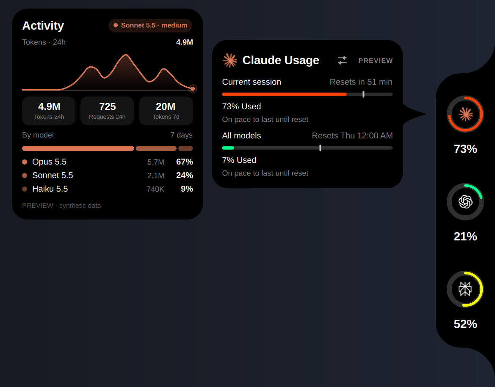
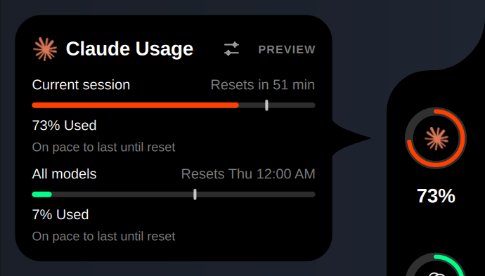
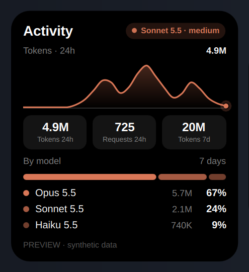
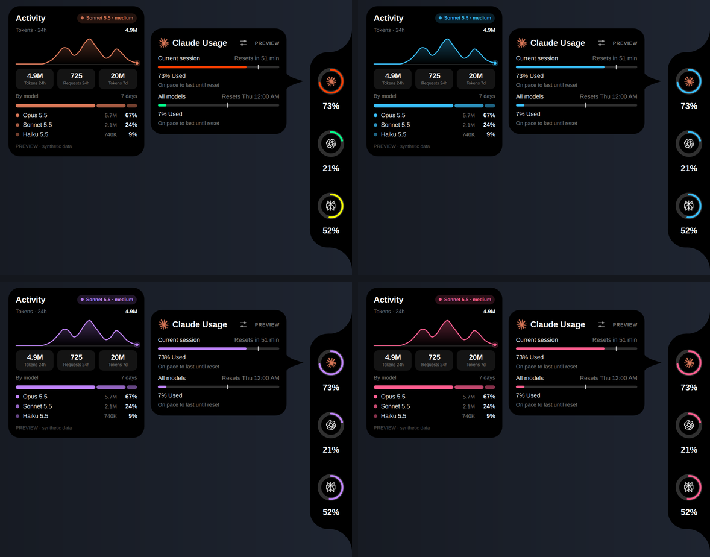
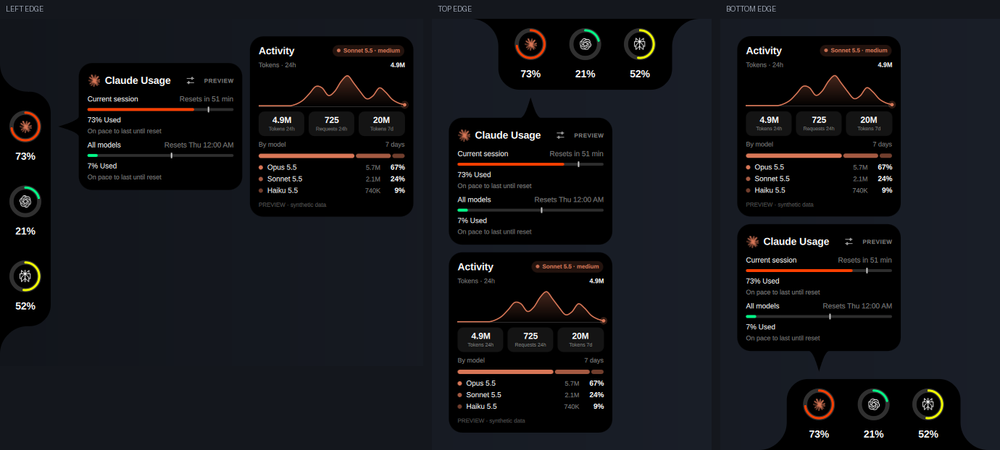

<div align="center">

# Omarchy AI Usage

**A native, edge-attached AI usage surface for [Omarchy](https://omarchy.org).**<br>
Watch Claude Code, Codex, Antigravity, and Cursor quota windows from a small notch on the edge of your screen.

[](https://github.com/Bappoz/omarchy-ai-usage/actions/workflows/ci.yml)
[](LICENSE)




<sub>Screenshots use the built-in synthetic preview data, never a real account.</sub>

</div>

## Features

**Quota at a glance**
- One ring per provider on a slim rail that folds into the screen edge when idle.
- The compact ring follows the shortest recognized window (for example Claude's 5-hour session); longer windows such as weekly stay in the expanded card.
- Explicit states for active, loading, stale, sign-in required, rate-limited, error, and unavailable.

**Pace, not just percent**
- A marker on every quota bar shows where an even burn rate would be right now.
- A one-line verdict projects when you would hit the limit, for example *"At this pace the limit hits in ~1d 14h"*, derived only from the reset time and window length already in the data.

**Activity panel**
- Opens beside the provider card with the current model and effort, a live indicator while it is in use, a 24-hour token sparkline with hover readout, 24h and 7-day totals, and a per-model breakdown.
- Built from local Claude Code and Codex session logs. Other providers show their quota windows but do not claim token totals without a supported local source. It can be turned off (see [Privacy](#privacy-and-security)).

**Make it yours**
- Any accent color (`#RRGGBB`), or the built-in provider tints and usage scale.
- Top, right, bottom, or left edge; continuous position; focused, named, or all displays.
- Small, medium, and large sizes; hover, click, or always-open behavior.

**Motion that feels right**
- Spring-based sweeps, entrances, and hover feedback inspired by [Sileo](https://tailkits.com/components/sileo/); rings appear only after the silhouette has finished unfolding and sweep in on every open.
- One switch (or `OMARCHY_REDUCED_MOTION=1`) turns all of it off.

**One click to the app**
- Click a provider logo, on the rail or in the card header, to open its app or web app.

## Gallery

<table>
  <tr>
    <td align="center"><br><sub>Usage card with pace markers and verdicts</sub></td>
    <td align="center"><br><sub>Activity panel</sub></td>
  </tr>
</table>

<div align="center">
<br>
<sub>Hover to unfold the rail, then a ring for its card and activity panel</sub>
</div>

### Accent colors



Default, `#38bdf8`, `#c084fc`, and `#ff5d8f`. Rings, bars, the sparkline, and model shares all follow the accent.

### Placement



## Requirements

- Omarchy 4.0 or newer with the Quickshell-based shell.
- The built-in `omarchy.agents` widget enabled, because it owns quota collection.
- Claude Code and/or Codex, already signed in for live usage.
- Python 3.11 or newer.

No third-party Python or JavaScript runtime dependency is required.

## Install

```sh
omarchy plugin add https://github.com/Bappoz/omarchy-ai-usage.git --enable
```

The notch appears at the right edge of the focused display. If the plugin was installed earlier but is disabled:

```sh
omarchy plugin enable ai-usage.notch
```

## Quick tour

| Do this | You get |
| --- | --- |
| Hover the edge pill | The rail unfolds and each ring sweeps in |
| Hover a ring | That provider's usage card, with pace markers and reset times |
| Keep the pointer on the card | The activity panel slides in beside it |
| Hover the sparkline | The token count for that hour |
| Click a provider logo | The provider's app opens |
| Click the sliders icon in the card | Preferences |

## Configure

Open a provider card and select the sliders icon. Each row cycles through its supported values, changes apply live, and they are saved through Omarchy's scoped plugin API. All four providers are enabled automatically; at least one provider stays enabled.

| Setting | Choices | Default | What it changes |
| --- | --- | --- | --- |
| Edge | Top, right, bottom, left | Right | Which screen edge owns the notch |
| Position | Start, center, end | Center | Where it sits along that edge |
| Display | Focused, all, a named connector | Focused | Which displays show it |
| Size | Small, medium, large | Medium | Notch, card, type, and ring scale |
| Open behavior | Hover, click | Hover | How the rail and card open |
| Auto-hide | On, off | On | Whether an idle rail collapses to the edge pill |
| Refresh interval | 5, 15, 30, 60 minutes | 15 minutes | Hidden fallback reread; a visible card requests fresh data every 30 seconds |
| Claude / Codex / Antigravity / Cursor | On, off | On | Which live providers appear |
| Provider label / reset time | On, off | On | Compact-surface density |
| Provider colors | Auto or preset per provider | Brand colors | Ring, quota bar, and activity chart colors |
| Accent color | Auto, seven presets, any hex via `shell.json` | Auto | Global fallback color; provider colors override it |
| Insights panel | On, off | On | The activity panel beside the card |
| Motion | On, off | On | Surface animation; off for a static UI |

For an exact connector or a continuous position, edit the plugin entry in `~/.config/omarchy/shell.json`:

```json
{
  "id": "ai-usage.notch",
  "edge": "left",
  "offset": 0.25,
  "monitor": "DP-1",
  "size": "small",
  "autoHide": true,
  "expandBehavior": "click",
  "pollingInterval": 300,
  "showProviderLabel": true,
  "showResetTimer": true,
  "animations": true,
  "accentColor": "#38bdf8",
  "showInsights": true,
  "enabledProviders": { "claude": true, "codex": true, "antigravity": true, "cursor": true },
  "providerColors": { "claude": "#d97757", "codex": "#74aa9c", "antigravity": "#3186ff", "cursor": "#edecec" }
}
```

`offset` accepts `0.0` to `1.0` along the edge, `pollingInterval` accepts 60-3600 seconds, and `accentColor` is `auto` or a six-digit hex (anything else falls back to `auto`). The full reference, defaults, and test-only overrides are in [Configuration](docs/configuration.md).

## How it works

| Source | Used for | Access |
| --- | --- | --- |
| `omarchy.agents` records in `~/.local/state/omarchy/agents/usage/` | Quota windows, percentages, reset times | Read-only watch; the built-in widget is the single writer |
| `omarchy-shell omarchy.agents refresh` | Fresh data when a card opens and every 30 seconds while visible | Fixed IPC request, single-flight, 15-second cooldown |
| Orca `account list --json` | Antigravity and Cursor quota windows | Local CLI output is normalized in memory; only quota percentages, reset times and plan labels reach the UI |
| Local session logs (`~/.claude/projects`, `~/.codex/sessions`) | Activity panel | Read-only, only while the panel is visible, aggregated in a helper; can be turned off |
| `gtk-launch` / `omarchy-launch-webapp` | Opening the app on logo click | Fixed commands, no user-controlled arguments |

Authentication stays with provider clients. Claude and Codex quotas come from Omarchy; Antigravity and Cursor quotas come from Orca. Gemini is intentionally not displayed as a separate provider. See [Provider feasibility](docs/provider-feasibility.md) for details.

## Troubleshooting

**Claude does not appear**
1. Confirm the built-in **Agents** widget (`omarchy.agents`) is enabled in the bar.
2. Confirm Claude Code is installed with `claude --version`.
3. Sign in with `claude auth login` only when Claude itself reports that authentication is required.
4. Open the card settings and make sure **Claude** is **On**.
5. Restart the shell after updating from a release older than 0.8.1.

**The activity panel says there are no logs or no activity**
It reads the session logs written by Claude Code and Codex. If you relocated them, `CLAUDE_CONFIG_DIR` and `CODEX_HOME` are honored. Antigravity and Cursor do not currently expose supported local per-request token logs to this panel, so it shows quota without fabricated token totals.

**Clicking a logo does nothing**
The plugin opens the provider's desktop app when available and otherwise opens its web app.

## Update

Updates preserve your preferences:

```sh
omarchy plugin update ai-usage.notch
omarchy restart shell
```

Then open a provider card once to request an immediate refresh. Do not use `omarchy refresh shell` for plugin updates: it resets shell configuration instead of updating this plugin. Verify the installed plugin with `omarchy plugin list`.

## Remove

```sh
omarchy plugin remove ai-usage.notch
```

## Development

```sh
make check
```

runs unit and contract tests, Python linting, QML linting, and the official Omarchy plugin validator. CI runs the portable subset on every push and pull request.

Probe the helpers directly:

```sh
python helpers/omarchy_agent_provider.py --provider claude   # normalized quota snapshot
python helpers/orca_usage_provider.py --provider antigravity # Orca quota snapshot
python helpers/orca_usage_provider.py --provider cursor      # Orca quota snapshot
python helpers/insights_provider.py --provider claude        # activity aggregates
```

Provider problems are reported as safe status objects and still exit successfully; invalid arguments exit with code 2. `OMARCHY_AI_USAGE_PREVIEW=1` enables the labeled synthetic composition used for the screenshots above.

```text
.
├── manifest.json
├── contracts/provider-snapshot.schema.json
├── helpers/            # quota normalization and activity aggregation
├── src/
│   ├── model/          # stores, runners, preferences, app launcher
│   ├── ui/             # rail, ring, card, activity panel, settings
│   └── Main.qml
├── tests/
└── docs/
```

Marketplace maintainers validate the current public commit before approval; see [Marketplace publishing](docs/marketplace-publishing.md) and [Release readiness](docs/release-readiness.md).

## Privacy and security

Omarchy plugins are not sandboxed, so this one keeps a narrow, documented data boundary:

- It never reads credential files, tokens, browser storage, or stores raw provider responses. It never starts Claude Code, Codex, or the Omarchy usage collector. It queries Orca's local quota CLI for Antigravity and Cursor and retains only sanitized quota fields. It launches an app only when you click its logo.
- Quota snapshots contain usage windows, percentages, reset times, and an optional plan label, never tokens or account identifiers.
- The activity panel is the one exception to "records only". Session logs contain conversations, so the helper keeps only a timestamp, model name, effort label, and token counts per request, and emits aggregates. Prompts, tool output, file paths, and session ids never leave it, and a test asserts that conversation text does not appear in its output. Disable the panel with `showInsights: false`.
- The repository contains no real provider output or account data.

See the [Security policy](SECURITY.md) for the full model.

## License and attribution

MIT. CodeNotch-derived visual geometry and bundled provider marks retain their attribution in [THIRD_PARTY_NOTICES.md](THIRD_PARTY_NOTICES.md) and [docs/acknowledgements.md](docs/acknowledgements.md). Motion design is inspired by [Sileo](https://tailkits.com/components/sileo/).
